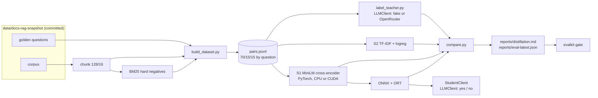

# llm-distill

Replace an LLM answerability check with a fine-tuned small cross-encoder, and measure honestly
what that buys and what it costs.

## Problem

[`docs-rag`](../docs-rag) asks an LLM "is the answer to this question contained in these
retrieved chunks?" on every request. That is a yes/no decision. A small encoder
fine-tuned on labelled `(question, passage)` pairs can make it on a CPU quickly, for a
small fraction of the cost. The tables below say how small. This repo builds the dataset from `docs-rag`'s own
corpus and golden set, labels it with a teacher, trains two students, and reports accuracy,
agreement with the teacher, latency, cost and size side by side.

**Read the results with the caveats below.** No API key exists on the machine that produced
them, so the teacher is a deterministic lexical-overlap heuristic and every teacher row is
labelled `fake-provider`. The student rows are real: the models were trained here and measured
here. The benchmark is also small and, as the slice table shows, easy.

## Architecture



## Run it

Needs `uv` and Python 3.12 (`uv python pin 3.12` is committed). Torch is the CPU wheel, which
keeps a fresh clone and CI small. The sibling repo `../llm-evalops` must exist (it provides
`evalkit gate`).

```bash
make setup      # uv sync, copy .env.example
make test       # offline; the model is mocked, no download
make lint

make data       # snapshot -> data/pairs.jsonl
make label      # teacher labels (fake provider unless OPENROUTER_API_KEY is set)
make baseline   # S2
make train      # S1 fine-tune + ONNX export (downloads the base model once)
make compare    # reports/distillation.md, reports/eval-latest.json, refreshes the table below
make gate       # evalkit gate against reports/baseline.json
make demo       # offline: BM25 results judged by the teacher and the student
```

`make demo` needs no network and no API key. Without `make train` it uses the TF-IDF student.
Without `make`, run the underlying `uv run python scripts/<name>.py` commands in the Makefile.

To use a real teacher, set `OPENROUTER_API_KEY` (and optionally `CHEAP_MODEL`) and rerun
`make label compare`; the teacher rows then lose the `fake-provider` label and the cost column
uses OpenRouter's reported cost.

### Training on a GPU

`scripts/train.py` uses CUDA whenever `torch.cuda.is_available()`. The pinned wheel is the CPU
build, so by default it trains on CPU, which is the configuration the results below were
produced with. To use a local NVIDIA GPU, replace the wheel in the virtualenv with a CUDA build
(for example `uv pip install torch --index-url https://download.pytorch.org/whl/cu128`; Blackwell
cards need CUDA 12.8 or newer) and rerun `make train`. `compare.py` always measures on CPU so
that the latency numbers are comparable.

## Results

Produced by `scripts/compare.py` from the held-out test split; the full report, with slices,
error breakdown and environment, is in [`reports/distillation.md`](reports/distillation.md).
Teacher rows are `fake-provider`.

<!-- results:start -->
**Quality** (held-out test split, 95% interval resampled by question)

| Model | Provenance | Accuracy [95% CI] | F1 (answerable) [95% CI] | Precision | Recall | Agreement with teacher | Size (MB) |
|---|---|---|---|---|---|---|---|
| teacher (fake-lexical-overlap-v1) | fake-provider | 97.8% [95.3, 99.6] | 85.7% [73.8, 97.1] | 75.0% | 100.0% | (is the teacher) | n/a (API) |
| s2-tfidf-logreg | trained on derived labels, measured on CPU | 98.4% [96.1, 100.0] | 89.2% [77.3, 100.0] | 80.5% | 100.0% | 99.4% | 0.1 |
| s1-minilm-torch | trained on derived labels, measured on CPU | 99.6% [99.0, 100.0] | 97.1% [92.8, 100.0] | 94.3% | 100.0% | 97.8% | 90.9 |
| s1-minilm-onnx | trained on derived labels, measured on CPU | 99.6% [99.0, 100.0] | 97.1% [92.8, 100.0] | 94.3% | 100.0% | 97.8% | 91.0 |

**Latency per decision** (milliseconds; CPU; includes tokenisation)

| Model | Provenance | p50 batch 1 | p95 batch 1 | p50 batch 32 | p95 batch 32 |
|---|---|---|---|---|---|
| teacher (fake-lexical-overlap-v1) | fake-provider | 0.03 (heuristic, not an LLM call) | 0.05 | n/a | n/a |
| s2-tfidf-logreg | trained on derived labels, measured on CPU | 0.56 | 0.64 | 0.09 | 0.09 |
| s1-minilm-torch | trained on derived labels, measured on CPU | 21.51 | 25.74 | 14.84 | 16.63 |
| s1-minilm-onnx | trained on derived labels, measured on CPU | 17.28 | 22.13 | 18.93 | 20.51 |

**Cost per 1,000 decisions** (USD)

| Model | Provenance | Batch 1 | Batch 32 | Basis |
|---|---|---|---|---|
| teacher (fake-lexical-overlap-v1) | fake-provider | $0.273857 | n/a | tokens x list price (projected), priced as anthropic/claude-haiku-4.5 |
| s2-tfidf-logreg | trained on derived labels, measured on CPU | $0.000016 | $0.000002 | measured CPU time at $0.10/h |
| s1-minilm-torch | trained on derived labels, measured on CPU | $0.000590 | $0.000423 | measured CPU time at $0.10/h |
| s1-minilm-onnx | trained on derived labels, measured on CPU | $0.000474 | $0.000530 | measured CPU time at $0.10/h |
<!-- results:end -->

## Dataset

Source: the `docs-rag` corpus and golden set, copied into `data/docs-rag-snapshot/` with the
commit SHA and date in `SNAPSHOT.json` (licence note in `data/SOURCES.md`). Pairs are
`(question, chunk)` with a binary label:

| Kind | Construction |
|---|---|
| positive | the golden question with its expected chunk |
| hard negative | the same question with the highest-BM25 chunks that do not contain the answer |
| easy negative | random chunks from other documents |

Refusal questions (nothing in the corpus answers them) contribute negatives only. Splits are
70/15/15 by question id, stratified by question type, so no question leaks across splits
(enforced by a test). Counts per split are in `data/pairs_stats.json`.

## Known limitations

- **The teacher is not an LLM.** Until a key is set, "teacher" means a lexical-overlap rule.
  Its agreement numbers say nothing about how a real LLM would do.
- **Students are trained on the derived labels, not on teacher labels.** That is the plan's
  design and it measures the best a student can do; distilling from a noisy real teacher would
  be the next experiment.
- **The benchmark is easy and small.** Most golden questions are template-generated and quote
  the passage they target, so lexical overlap is a strong signal; this is why the TF-IDF
  baseline is close to the cross-encoder. The test split has few answerable pairs, which is why
  the table carries bootstrap intervals (resampled by question). Differences inside those
  intervals are not evidence.
- **One corpus.** Nothing here shows the student transfers to another documentation set.
- **Single-passage decisions.** The student judges one chunk at a time, like the teacher prompt;
  it does not reason across chunks.
- **Latency is on one machine.** Numbers are CPU measurements on the machine listed in the
  report. Teacher latency against a real API was not measured.
- **Cost model.** Student cost is measured CPU time at a stated USD/hour (`CPU_USD_PER_HOUR`);
  it excludes idle capacity. Teacher cost is the pricing-table price for the model family when
  the exact model id is missing from `pricing.json`, and says so in the report.
- **Docker.** The `Dockerfile` was written but not built (Docker was not running).
- **`docs-rag` is untouched.** The switch below is documented, not applied.

## Using the student in docs-rag

`StudentClient` implements the same `LLMClient` protocol as the provider backends and answers
`yes` or `no`. In this repo:

```bash
LLM_PROVIDER=student STUDENT_BACKEND=onnx uv run python -c \
  "from llm_distill.llm import get_client; print(get_client().provider)"
```

To use it from `docs-rag`, add this package as a path dependency (`uv add ../llm-distill`),
register a `student` branch in `docs_rag.llm.factory.get_client` that returns
`llm_distill.client.student_client()`, and set `LLM_PROVIDER=student`. The prompt format is
`llm_distill.prompts.build_messages` (tagged `<question>` and `<passage>` blocks); a plain
`Question: ... Passage: ...` prompt is also accepted.

## Design notes

**Why answerability is a good distillation target.** The output space is two labels, the input
is short, and the label is checkable against the golden set, so there is little room for the
student to be "plausibly wrong". It runs on every request, which makes it the highest-volume LLM
call in the pipeline, and it needs no generation, so a classifier loses nothing in fluency.

**Why hard negatives matter.** Easy negatives (a random page about on-call rotas) are rejected
by any model, so a benchmark made only of them says nothing. The hard negatives are what a real
retriever returns: on-topic chunks that share the question's vocabulary but lack the fact. The
slice table separates the two, and that is where the models differ.

**Label noise and how it was measured.** There are three label sources: the derived ground
truth, the teacher, and the student's own output. Teacher noise is measured as teacher agreement
with the derived truth per split and broken down by pair kind in the report. The ground truth
has its own noise: the handbook repeats some facts across pages, so the builder drops any
negative that contains the answer phrase (found while testing; one release-train fact appears
on two pages).

**When you would not distil.** When the decision needs world knowledge or multi-document
reasoning; when the traffic is too low for the saving to matter (the LLM bill is already
negligible); when the labelled set is not representative of production; or when requirements
change often, since each change means relabelling and retraining.

**How to monitor the student in production.** Log the score, not just the verdict. Track the
yes-rate and the score histogram against the validation distribution (drift shows up there
first). Send a small random sample of decisions, plus everything near the threshold, to the
teacher and track agreement over time. Keep the golden set in CI behind `evalkit gate`, and
alert on a falling agreement rate or a shifting threshold-region mass.

## Layout

```
data/docs-rag-snapshot/  corpus + golden set + SNAPSHOT.json (committed)
data/pairs.jsonl         generated pairs (committed)
src/llm_distill/         dataset, teacher, students, compare, StudentClient, LLM backends
scripts/                 build_dataset, label_teacher, train_baseline, train, export_onnx,
                         compare, demo
evals.yaml               metric thresholds for `evalkit gate`
reports/                 distillation.md (committed); eval JSON is generated
```
